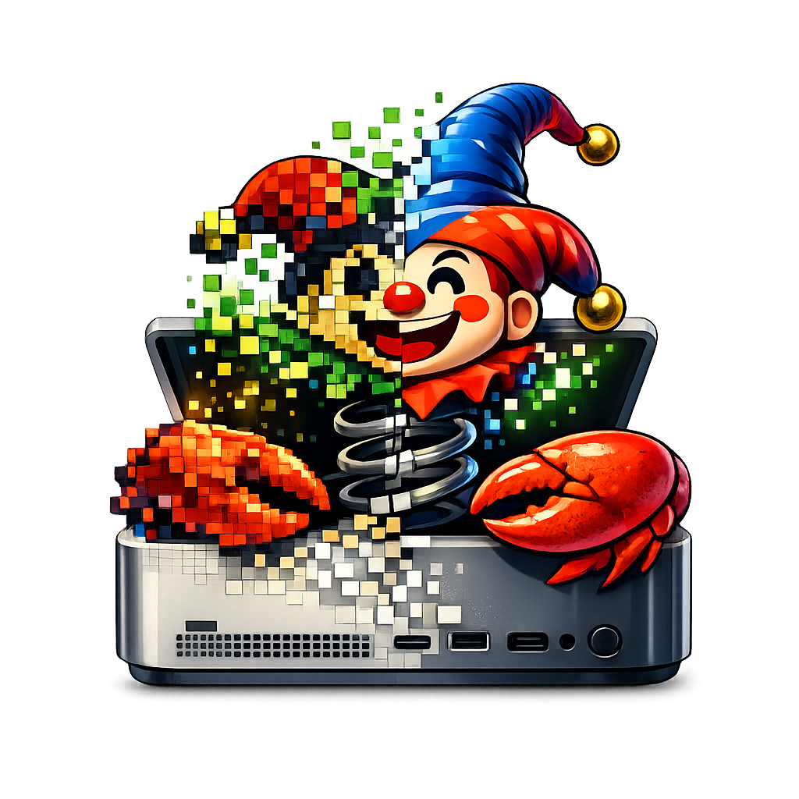
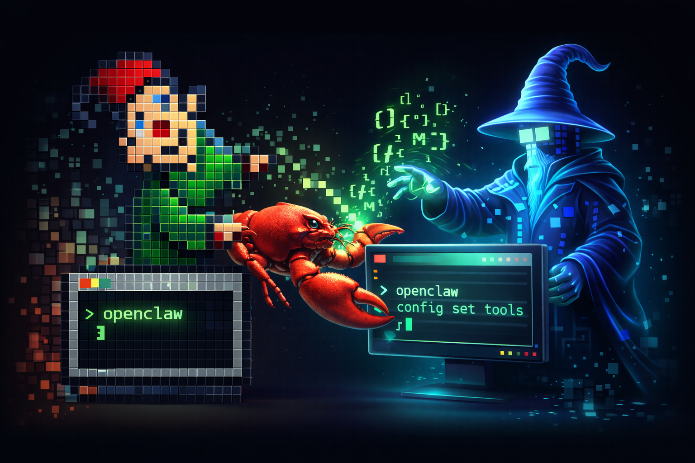

# ClawEdit

<p align="center">
  
</p>

<p align="center">
  ResEdit-inspired macOS utility for the privacy prompts, bridge exports, and system settings that OpenClaw-style tooling needs.
</p>

<p align="center">
  <a href="https://www.matthewxmurphy.com">Website</a>
  ·
  <a href="mailto:hello@matthewxmurphy.com">Email</a>
  ·
  <a href="https://github.com/matthewxmurphy/clawedit">GitHub</a>
</p>



## What It Is

`ClawEdit` is a native macOS SwiftUI app for the annoying local setup work that should not live in chat prompts:

- Full Disk Access and privacy readiness tracking
- bridge-capability export for Linux/OpenClaw workflows
- GitHub-based unsigned distribution
- Wake-on-LAN and Homebrew bridge planning
- old-Mac personality instead of sterile setup UI

It is named after `ResEdit` on purpose.

## Current Features

- SwiftUI desktop app shell for macOS 14+
- bundled art for the Dock/app icon and About window
- capability toggles for `iMessage`, `Reminders`, `Notes`, `Homebrew Bridge`, `Wake-on-LAN`, and `Keep Awake`
- JSON export to `~/Library/Application Support/ClawEdit/bridge-config.json`
- GitHub release checking
- custom About window
- hidden snake mini-game when you hold `Option` and choose `About ClawEdit`

## Build

```bash
git clone https://github.com/matthewxmurphy/clawedit.git
cd clawedit
swift build
swift run
```

## Why It Exists

OpenClaw can do a lot, but macOS still puts real work behind local privacy controls, Apple Events permissions, Full Disk Access, data store access, and trust prompts. `ClawEdit` is the Mac-side utility for making those states visible and exportable instead of rediscovering them through broken automations.

## Roadmap

- real macOS permission-state checks instead of placeholder notes
- export formats that Linux bridge skills can consume directly
- a proper `.app` packaging flow for unsigned GitHub releases
- richer About panel and more retro easter eggs

## License

MIT

## Maintenance

Author/developer: Matthew X Murphy, https://MatthewxMurphy.com. Product attribution:
https://builtnotbegged.com. Existing MIT licensing and copyright are preserved.
[Release lookup verification](docs/RELEASE-CHECKS.md) documents the offline native
checks, current build-environment limitation and source/release boundaries.
